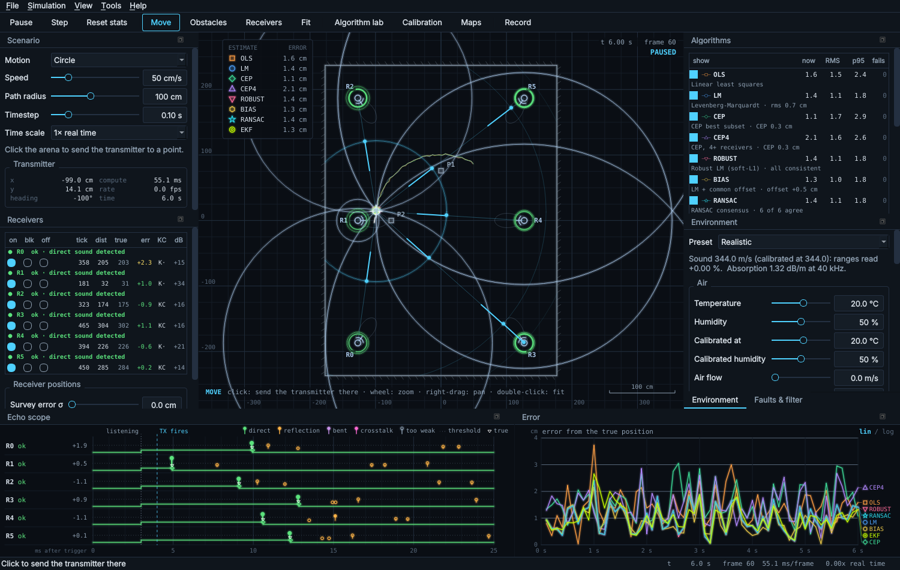
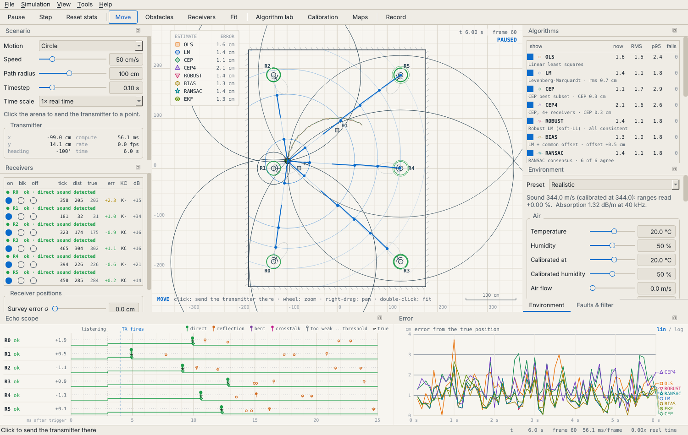
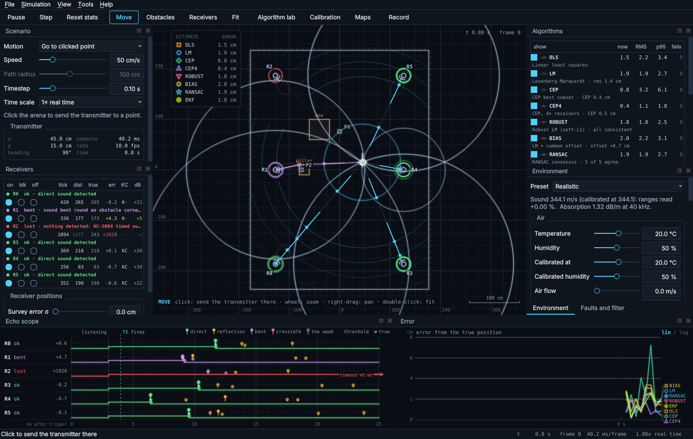
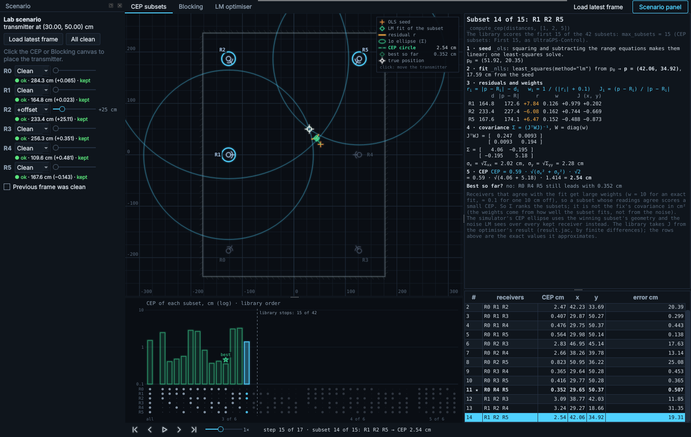
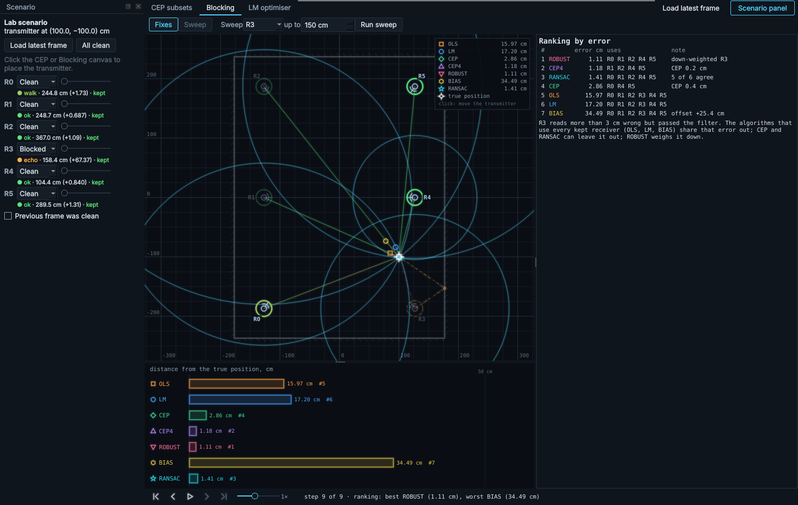
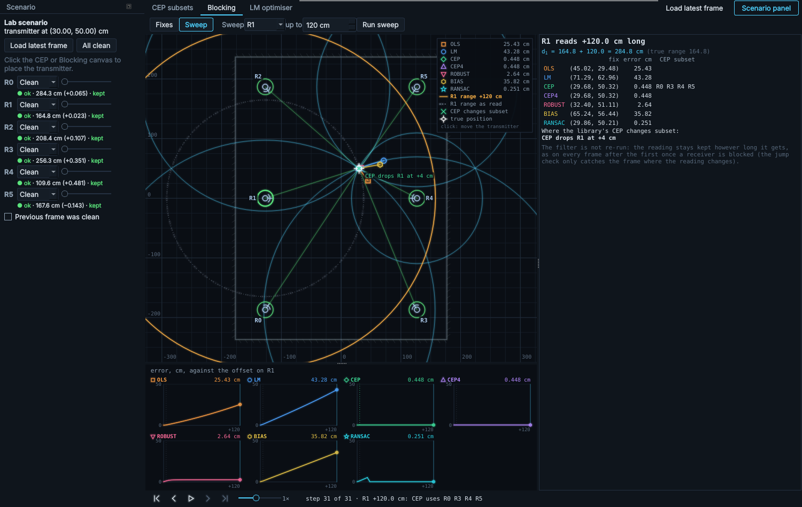
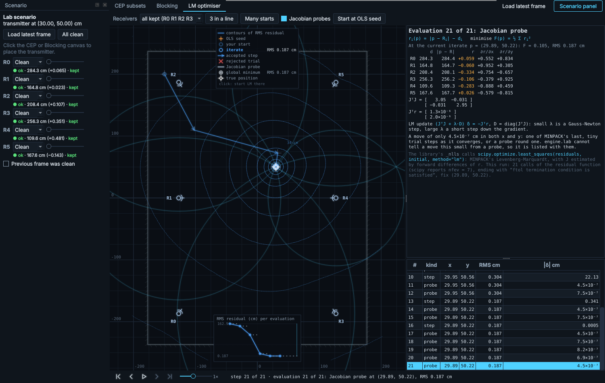
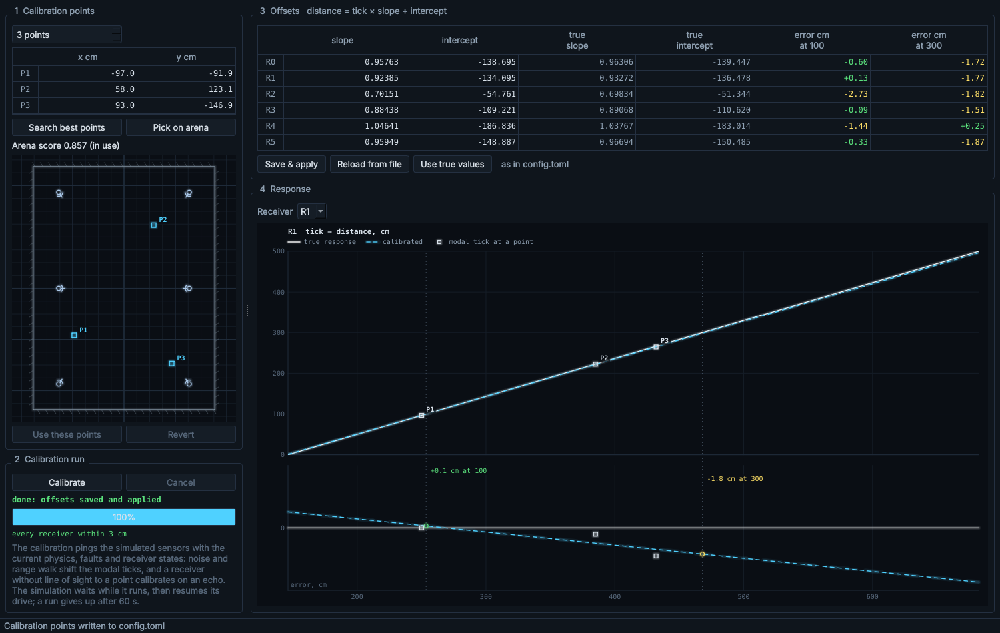
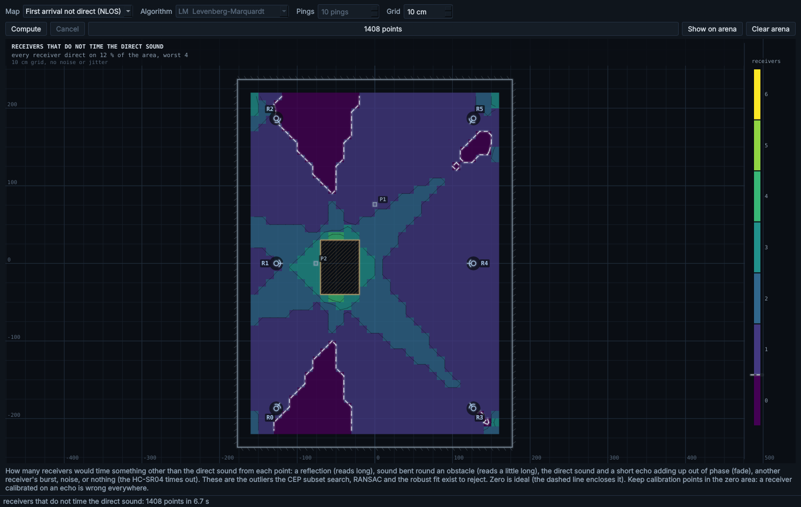
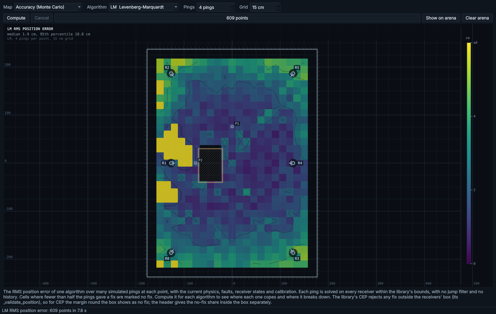

# UltraGPS Simulator — Manual

This is the manual for the `max-effort` rewrite of the UltraGPS positioning
simulator. It covers what was rebuilt and why, how to use every window, the
physics the simulator now models, the positioning algorithms it compares, and
how each part can help with the real system.



## Contents

1. [What changed](#1-what-changed)
2. [Running it](#2-running-it)
3. [The main window](#3-the-main-window)
4. [How a ping is simulated](#4-how-a-ping-is-simulated)
5. [Positioning algorithms](#5-positioning-algorithms)
6. [The algorithm lab](#6-the-algorithm-lab)
7. [Calibration](#7-calibration)
8. [Maps](#8-maps)
9. [Recording and replaying real data](#9-recording-and-replaying-real-data)
10. [Benchmark results](#10-benchmark-results)
11. [What the simulator says about the real system](#11-what-the-simulator-says-about-the-real-system)
12. [Code map and how to extend it](#12-code-map-and-how-to-extend-it)
13. [Assumptions and limits](#13-assumptions-and-limits)

---

## 1. What changed

| | Before (`main`) | Now (`max-effort`) |
|---|---|---|
| Toolkit | One matplotlib figure, widgets placed by coordinates, a second figure for calibration | PyQt6 (the same toolkit as UltraGPS-Control): a main window with dockable, floatable, tabbable panels, menus, a toolbar, keyboard shortcuts, a remembered layout, and separate tool windows |
| Look | Default matplotlib plot | A 2D vector-display style: thin glowing lines on a dark field (or ink on paper), outlined markers, hatched obstacles, monospace labels; exports to SVG |
| Sound | Straight-line range plus Gaussian noise and random faults | A model of one ping through the real hardware: beam patterns, spreading, air absorption, threshold detection with range walk, loss of signal, reflections off walls and obstacles, sound bending round corners, a direct sound and its echo interfering, ambient ultrasonic noise, module-to-module differences, wind, radio trigger timing and loss, the HC-SR04 timeout and the base station's sampling window |
| Room | None | Walls and obstacles (`config/world.toml`), drawn and edited in the arena |
| Algorithms | OLS, LM, CEP (library) and CEP4 | The same, plus robust LM, LM with a common offset, RANSAC and a Kalman tracker, all outside the library |
| Seeing inside the algorithms | Error numbers | The algorithm lab: the library's CEP subset search, the effect of blocked receivers, and the LM optimiser, step by step and animated, with the equations and numbers |
| Seeing inside the sensor | Status colour | The echo scope: every sound arrival at every receiver, its strength against the detection threshold, and the moment each echo line dropped |
| Analysis | — | Coverage, geometry (HDOP), multipath, range-bias and Monte-Carlo accuracy maps; a benchmark of every algorithm, with a regression check against a recording; recording to CSV or a tick log; replay of real base-station logs, serial-monitor captures included |
| Libraries | `ultragps_position`, `ultragps_calibration` | **Unchanged.** A test checks their SHA-256 hashes. New ideas live in `engine/` |

The positioning and calibration libraries are exactly the copies on `main`
(the ones from UltraGPS-Control with the changes you asked for earlier). The
simulator only calls them, and the algorithm lab watches them by wrapping
their methods for the length of one call; nothing in them was edited.

## 2. Running it

Python 3.11 or later.

```bash
python3 -m pip install -r requirements.txt     # PyQt6, numpy, scipy
python3 app.py
```

Options:

```bash
python3 app.py --preset Ideal           # Ideal, Realistic (default) or Harsh physics
python3 app.py --palette paper          # light theme
python3 app.py --config path/to/config.toml --sensors path/to/sensors.toml --world path/to/world.toml
python3 app.py --seed 1                 # repeatable randomness, the same simulated modules every run
python3 app.py --screenshot shot.png --frames 60 --size 1600x1000   # render and exit
```

Command-line tools (no window):

```bash
python3 -m engine.benchmark --frames 400      # every algorithm under standard conditions (section 10)
python3 -m engine.benchmark --compare rec.csv # replay a recording; how far today's fixes are from the recorded ones
python3 -m engine.cal_points                  # best calibration points for the room (section 7)
python3 -m engine.cal_points --apply          # ... and write them into config.toml
python3 -m unittest discover -s tests -t .    # the test suite
```

On a machine without a display, set `QT_QPA_PLATFORM=offscreen`.

`--compare` is a regression check after changing the calibration or the
solvers: it replays a CSV the simulator recorded, with the calibration in
config.toml and the default solver settings, and prints for each algorithm
the mean and largest distance (cm) between today's fixes and the recorded
ones. The first frames can differ, because the recording does not hold the
solvers' memory from before it started. A tick log has no recorded fixes, so
`--compare` refuses it.

## 3. The main window

The arena sits in the middle. Every panel round it is a dock: drag its title
to move it to another edge, drop it on another dock to stack them as tabs,
double-click the title (or its float button) to float it as its own window
(on a second monitor, for instance), or close it with its close button and
bring it back from **View**. The layout and the palette are remembered between
runs; **View > Reset layout** rebuilds the default arrangement at the current
window size (Environment tabbed in front of Faults and filter, the echo scope
and the error chart side by side along the bottom). The algorithm lab,
calibration and maps are separate windows, so they can sit next to the arena
instead of replacing it.



### 3.1 The arena

The arena draws what the sound did on the latest ping, in layers you can switch
off under **View > Arena layers**:

| Layer | What it shows |
|---|---|
| Grid | 25 cm and 100 cm lines (coarser when zoomed out) and the axes, labelled in cm; the scale bar at the bottom right stays when it is off |
| Walls and obstacles | The room's walls (ticked on the outside) and obstacles (hatched) |
| Beam patterns | Each receiver's beam pattern as a polar plot of its sensitivity (and the transmitter's, when it is not omnidirectional), drawn along the receiver's real beam axis, which its module's mounting error turns a little off its nominal facing; with the hard field of view on, dashed lines at its limits |
| Measured ranges | A ring of the measured distance round where the library *believes* each receiver is; dotted when the library's filter dropped that reading |
| Sound paths | The path the detected sound really took: straight, bounced off a wall or obstacle (an echo), bent round a corner, or another receiver's burst; a dotted red line where the line of sight is blocked |
| Wavefronts | The ping slowed right down: the wave spreading from the transmitter (shadowed by obstacles), echoes spreading from their image sources, each receiver's ring flashing when its sound arrives |
| Trails | The last 40 fixes of each shown algorithm (the true position has no trail) |
| Estimates | Each algorithm's fix, one marker shape and colour each; hollow and dim when it has no fix this frame and holds its last one |
| Uncertainty ellipses | The 2σ ellipse of each fix's covariance in cm², where the algorithm has one (off at start). For CEP it is the winning subset's geometry scaled by the noise level LM's residuals show over every kept receiver, so when CEP has dropped a receiver that disagrees, its ellipse is large; one whose 2σ exceeds 10 m is not drawn |
| Labels | Receiver names and obstacle names |
| Calibration points | P1 to P4; orange while picked in the calibration window but not yet in use |
| Legend | Each shown algorithm's error this frame |
| Map overlay | A map from the maps window (section 8), with its contour lines |

Hover over a receiver for its reading in full (status, tick, distance, the
arrival it detected and its strength, its beam axis when it is mounted at
least 0.5° off, and the moment noise tripped it), or over a fix for the
algorithm's details. The status line under the window shows the cursor's
coordinates.

The top-right corner of the arena is a small HUD: the simulated time and
frame, and **PAUSED**, **REPLAY** *file*, **REC** *n* (frames recorded) or
**CALIBRATING** *run k · N reads* while those are going on. If a simulation
step ever fails, the simulation pauses and the HUD shows **STOPPED** with the
error (details on the console); **Run** tries again.

The mouse works in one of three tools (toolbar or **Tools**):

| Tool | Key | Left mouse | Also |
|---|---|---|---|
| Move | M | Click: send the transmitter there | |
| Obstacles | O | Drag: draw a rectangular obstacle | Right-click an obstacle: delete it |
| Receivers | E | Drag a receiver: move where it *really* is (the library keeps the config.toml position, so this is a survey error) | Wheel over a receiver: turn it 5° |

The transmitter never drives through an obstacle, however fast it goes: it
stops 0.5 cm short of the first edge in its way, then picks its next waypoint,
or, on a circle or figure eight, waits until its path is clear again. A click
inside an obstacle only sends it as far as the obstacle: it stops 0.5 cm short
of the edge in its way. **Put transmitter in the centre** or a calibration
point inside an obstacle puts it 1 cm outside the nearest edge; one already
inside an obstacle drawn over it can drive out. Walls do not stop it.

In every tool the wheel zooms, right- or middle-drag pans, double-click fits
the room and Esc goes back to Move. Edits never wait for the simulation: while
it runs they take effect from the next frame, and while it is paused the arena
and the docks redraw at once. **File > Save world** writes the walls and
obstacles to a `world.toml` for next time (`--world` loads one);
**File > Export arena as SVG** saves the arena as a vector drawing. Save
dialogs add the chosen filter's extension when the name has none; a save that
fails shows a warning, and one that works says where it went in the status
bar.

### 3.2 The docks

| Dock | What is in it |
|---|---|
| **Scenario** | Motion (click to go, circle, figure eight, lawnmower, random waypoints), speed, path radius, timestep (0.1 s is the base station's 10 Hz), time scale, and a readout of the transmitter and the frame rate |
| **Receivers** | One row per receiver: on, blocked or off; what its sensor did this ping in words; the tick it reported, the distance the library makes of it (values of 10 000 cm or more shortened, e.g. 12k), the true distance and the error; **K** if the library's filter kept it and **C** if it is in the CEP's best subset; the detected sound's strength over the threshold in dB. Under it, **Survey error σ** moves the real receivers away from where config.toml says they are, and **Re-roll** draws a new error |
| **Algorithms** | One row per algorithm: show it or not; its error now, RMS and 95th percentile over the last 300 frames, and failed frames; under it, its name and a note (the CEP value for CEP and CEP4, LM's rms, BIAS's offset, RANSAC's agreement, ROBUST's down-weighted receivers, the EKF's ranges used or gated, or why there is no fix); the receivers in CEP's subset are the C marks in Receivers. Under it, the solver settings (section 5), starting with **CEP subsets**, and **Reset stats** |
| **Environment** | A preset, the speed of sound and absorption they make, then every physical effect of section 4.1 in five groups: Air, Transducers, Detection, Propagation, and Timing & electronics. Every control has a tooltip saying what it does; controls that only matter with another one on are greyed out without it |
| **Faults and filter** | Injected faults (range noise, dropouts, lost signal, bad values and how bad), and the library's own filter: top-band reject and jump filter |
| **Echo scope** | One row per receiver, like a logic analyser (below) |
| **Error** | Each shown algorithm's error over time, every frame even when the display skips some; click **lin / log** to switch the scale, hover for the values at a moment |

A receiver that is **blocked** has something standing in its line of sight:
neither the direct sound nor sound bending round a corner can reach it, but a
reflection (or another receiver's burst) still can, so it may read long or
short, or lose the signal. A receiver that is **off** is unplugged: the base
station reads 0 for it.

### 3.3 The echo scope

The echo scope shows *why* each receiver read what it did. Each row is one
receiver's echo line on the time axis of the ping (milliseconds after the
base station's trigger). The line goes high when the receiver starts
listening and drops when it detects sound; that moment is the reading. Each
stem is a sound arrival, as tall as its strength over the detection threshold
and coloured by path: direct, reflection, bent round an obstacle, or another
receiver's burst. The detected arrival is drawn bold, arrivals too weak to
detect hollow, and a small triangle marks when the direct sound would arrive.
A receiver tripped by ambient noise shows a zigzag labelled *noise* at that
moment; one whose arrivals faded (status `fade`) has its tooltip explain how
they added up; one that detected nothing but still dropped its line is
labelled with its timeout.



Here a pillar stands between the transmitter and R1 and a box in front of R2.
R1 has no line of sight, but the sound bends round the pillar (status
`bent`): its reading is 4 cm long and only 5 dB over the threshold. R2 hears
nothing strong enough at all: its echo line stays high until the HC-SR04
gives up 38 ms after it started listening, 41 ms after the trigger (status
`lost`, a reading of 12.7 m), which the library's top-band reject then drops.
The other receivers detect the direct sound first; the reflections off the
walls arrive later and are ignored.

### 3.4 Menus and keys

| Key | Action |
|---|---|
| Space | Run or pause |
| Right | Pause and step one frame |
| R | Reset statistics and solver memory |
| F | Fit the arena to the window |
| C | Put the transmitter in the centre |
| M, O, E | Move, Obstacles and Receivers tools |
| Ctrl+0 … Ctrl+5 | Switch receiver R0 … R5 on or off |
| Ctrl+L | Algorithm lab |
| Ctrl+K | Calibration |
| Ctrl+M | Maps |
| Ctrl+R | Start or stop recording |
| Ctrl+O | Replay a tick log |
| Ctrl+S | Save the world |
| Ctrl+P | Save a screenshot |
| F1 | This manual |

The one-key shortcuts give way to a focused control that uses the key: a
focused check box or button keeps Space, a slider or list keeps the arrows,
Home, End, PgUp and PgDn, a tab bar keeps Left and Right, and a drop-down list
keeps Space, Up, Down, Home, End, PgUp, PgDn, letters and digits. Click the
arena to give the keys back to the shortcuts. Ctrl and Alt shortcuts always
work. **Help > Keyboard shortcuts** lists every key, the arena's mouse actions
and the lab's keys.

**File** has replay, recording, **Save last recording**, saving the world,
clearing obstacles, SVG export and screenshots; **Simulation** has run
control, the motion modes and the physics presets (each with a tick on the
one in use; *Custom* is ticked once the environment matches no preset);
**View** has every dock, the arena layers, the palette (vector or paper), fit
and reset layout; **Tools** has the three tool windows and the arena tools;
**Help** has this manual and the list of shortcuts.

At 2× speed or more on a slow machine the windows skip frames rather than
fall behind: they always show the latest one, and the status bar's real-time
rate is lower than the speed asked for. Any unexpected error goes to the
console and the status bar; the window keeps running.

## 4. How a ping is simulated

The simulator follows one ping through the real system, in the order the
firmware does it (`UltraGPS-Arduino/base-station/src/main.cpp`):

1. **Trigger.** The base station fires all six receiver HC-SR04s at once
   (t = 0). Each one raises its echo line when it is ready to listen
   (`rx_ready_ms`, 3 ms; the firmware notes the sensor "needs about 3 ms to
   send the burst and go into receiver mode").
2. **Transmitter.** The transmitter fires `burst_lead_ms` later on its radio
   trigger. The firmware asks for 2 ms (`SONIC_BURST_DELAY`); the calibration
   says about 4 ms in practice (an intercept of about −139 cm at 0.96 cm per
   tick is 145 ticks, about 4 ms), so the default is 4 ms. The radio link has
   no retries, so a trigger can be lost (`radio_loss`), and its timing can be
   off (`sync_offset_us`) or jitter (`sync_jitter_us`) — the same for every
   receiver.
3. **Sound paths.** The sound reaches each receiver along every path the room
   allows: straight, bounced off walls and obstacles (up to two bounces), or
   bent round an obstacle's corner when the straight line is blocked.
   Obstacles that touch each other or a wall leave no gap for sound to slip
   through. A transmitter inside an obstacle is silent.
4. **Strength.** Each arrival's strength over the detection threshold is

   `strength = SNR(1 m) × module gain × beam_tx(angle) × beam_rx(angle) × spreading × absorption × reflection × diffraction`

   with every term from section 4.1, and a little random turbulence
   (`amp_jitter_db`). No two HC-SR04 modules are alike, so each receiver has
   its own gain and is mounted a little off its nominal facing, drawn once per
   receiver from the seed.
5. **Detection.** The receiver's comparator fires on the first 40 kHz cycle at
   which the burst it hears, ringing up through the resonant transducers,
   crosses its threshold. A strong arrival is caught on the first cycle; a
   weak one a few cycles later (each cycle is 25 µs, 0.86 cm); one too weak
   never. Arrivals within one burst of each other (the direct sound and a
   short echo off a nearby wall) add up in or out of phase first, so they can
   be caught early, late or not at all. Otherwise the receiver latches the
   **first** arrival it detects, so if the direct sound is blocked or too
   weak, it reads a reflection instead. Ambient ultrasonic noise can trip the
   comparator before any of them.
6. **Timeout.** The HC-SR04 gives up `timeout_ms` (38 ms) after it starts
   listening and drops its echo line anyway: a very high value. A detection
   later than that is lost the same way.
7. **Sampling.** The base station counts loop iterations until each echo line
   drops; it stops sampling at 80 % of the frame (`window_ms`, 80 ms at 10 Hz;
   a separate setting that does not follow the Timestep). A line still high
   then, or a pin with nothing on it, reads 0, however late the sound would
   have been detected.
8. **Ticks.** The time becomes ticks through each receiver's true response in
   `config/sensors.toml`. The sampling loop starts at a random phase to the
   sound (`tick_dither`), so readings wobble by ±1 tick.
9. **Faults.** Injected faults go on top: range noise (1 cm σ by default) and,
   optionally, dropouts, lost signal and bad values.

### 4.1 The physical effects

| Effect | Model | Control | What you see | Why it matters on the real system |
|---|---|---|---|---|
| Speed of sound | (331.3 + 0.606·T) m/s for dry air, corrected for the water vapour's lighter molecules and heat capacity (vapour fraction from ISO 9613-1): 344.05 m/s at 20 °C and 50 %; dry to saturated adds 1.3 m/s at 20 °C, 2.4 at 30 °C, 5.6 at 45 °C | Temperature, Humidity, Calibrated at, Calibrated humidity | Every range scales by c_cal / c | At 50 % humidity, 10 °C warmer than at calibration = 1.9 % short (5.6 cm at 3 m); 10 °C colder = 1.9 % long |
| Absorption | ISO 9613-1 at 40 kHz (about 1.3 dB/m in a room) | Temperature, humidity | Far receivers get weaker, so detect later | Ultrasound fades about 280 times faster than 1 kHz sound; humidity matters |
| Spreading | 1/r amplitude | — | Strength falls 6 dB per doubling of distance | Sets the useful range |
| Beam patterns | Circular piston, −6 dB at ±27.5° (400ST/SR160-type transducers), nulls filled in, falling smoothly from 90° off axis to −30 dB behind (120° and beyond) | Beam patterns on/off, RX half-angle, TX beam (All round, Along its heading, Fixed direction), TX half-angle, TX facing | Off-axis receivers detect later, then not at all; lobes drawn on the arena | Which receivers can hear which parts of the arena depends on how they are aimed |
| Module spread | Each receiver's sensitivity off the nominal by a normal draw with σ = 1.5 dB, and its axis by σ = 3°, drawn once per receiver (the same modules for the same `--seed`) | Module spread, aim spread | Some receivers detect later and lose weak signals first; their lobes point a little off | Calibration absorbs each module's average delay, but not how its range walk changes over the arena |
| Threshold detection, range walk | Envelope 1 − e^(−t/τ), τ = 6 cycles, 8-cycle burst; first cycle over the threshold | Threshold detection, signal margin, ring-up time, turbulence | Weak signals read up to several cm long; status `walk` | A bias that depends on position and angle, which a straight-line calibration cannot remove |
| Loss of signal | No cycle crosses the threshold within the burst, or the detection comes after the module's timeout | — | Status `lost`: the timeout's high value | The high values the top-band reject exists for |
| Interference | Arrivals within one burst of each other add as 40 kHz phasors before the comparator sees them | Interference | Status `fade`: detected early, late or not at all | Near a wall the direct sound and its echo overlap: in the default room about one reading in five fades with the transmitter within 10 cm of a wall (one in two within 2 cm), about one in sixty at 10 to 30 cm, practically none further in |
| Ambient noise | Random noise bursts (air leaks, keys, other ultrasonic devices) trip a comparator at a rate per second of listening | Ambient noise (0 /s; 2 /s in Harsh) | Status `noise`: a random, short reading | Short outliers, unlike the long ones echoes make |
| Reflections (multipath) | Image sources, up to 2 bounces, reflectivity per surface | Reflections, Bounces, obstacles; the walls' and each obstacle's reflectivity in world.toml (0.6 and 0.7 by default) | Status `echo`: reads long by the extra path | When the direct sound is blocked or out of the beam, a wall echo is caught instead: large, one-sided errors |
| Diffraction | Shortest path round an obstacle's corners, knife-edge loss per corner (ITU-R P.526); a clear path passing close to a corner loses up to 6 dB (its Fresnel zone is partly blocked), so the level fades smoothly into the shadow | Diffraction | Status `bent`: a little long and weak | Sound does reach a receiver behind a small obstacle, late and weak |
| Wind | Each leg's speed c + w·û | Air flow, flow direction | Ranges upwind long, downwind short | A fan or air conditioning skews positions |
| Trigger timing | Common offset and jitter | Trigger offset, trigger jitter | All ranges shift together | A common error that the BIAS solver removes |
| Radio loss | Transmitter never fires | Radio loss | Every receiver times out: status `radio` | One lost frame; the solvers must hold |
| Timeout vs window | 38 ms timeout inside an 80 ms window → high value; a clone with a 200 ms timeout → 0; the limits apply to every reading, so a detection after the timeout reads lost and one after the window 0 | Module timeout, Sampling window | `lost` (high) or `missed` (0) | Explains whether a dead reading shows as 0 or as a huge distance |
| Listen delay | Arrivals before `rx_ready_ms` are missed | RX ready, TX delay | Close to a receiver, the direct sound can arrive before it listens | A blind zone if the transmitter fires too early |
| Crosstalk | Receivers' own bursts are heard by the others (directly, bent round obstacles or, with Reflections on, by echoes), and each receiver hears its own burst's echo off the walls and obstacles, even with Reflections off | Crosstalk | Status `crosstalk`: reads short | If the receivers' transmit transducers are not covered, a facing receiver's burst arrives before the transmitter's and is caught first |
| Survey error | True receiver positions differ from config.toml | Survey error σ, dragging receivers | Ghost receivers on the arena | Tape-measure errors in tower positions become position errors |
| Hard field of view | Nothing heard outside ±15° of the receiver's real axis | Hard field of view, field of view ± | Status `angle`, 0 ticks; dashed red lines | The earlier simple model, kept for comparison |
| Near noise | Extra noise within 16 cm | Near-field noise, near-field distance, near-field noise σ | Status `near` | The earlier simple model, kept for comparison |

Presets: **Ideal** turns every physical effect off except the 400 cm range
limit (status `range`) and injected faults (the first simulator's model).
**Realistic** is the default. **Harsh** lowers the signal margin to 24 dB,
doubles the turbulence (2 dB), second bounces, 30 µs trigger jitter, 2 % radio
loss, a light draught and ambient noise (2 per second).

Every reading gets a status, shown in its colour in the Receivers dock, the
echo scope and on the arena:

| Status | Meaning |
|---|---|
| `ok` | Direct sound detected |
| `walk` | Direct sound detected two or more cycles late (weak signal) |
| `echo` | A reflection detected: reads long |
| `bent` | Sound bent round an obstacle detected: reads a little long |
| `fade` | Overlapping arrivals interfered: detected late, early or not at all |
| `noise` | Ambient noise tripped the comparator first: a random, early reading |
| `crosstalk` | Another receiver's burst detected: reads short |
| `lost` | Nothing detected before the module's timeout: a very high value |
| `missed` | The echo line did not drop within the sampling window: 0 |
| `radio` | The transmitter missed its radio trigger |
| `angle`, `range`, `near` | The simple model's hard field of view, range limit (with threshold detection off) and near-field noise |
| `off` | Switched off: 0 |
| `dropout`, `timeout`, `spike` | Injected faults: a missed reading (0), a lost signal (high value), a wrong value |

## 5. Positioning algorithms

All algorithms see the same frame. OLS, LM and CEP come from the
`ultragps_position` library, called as UltraGPS-Control's position window
calls it: `get_position_full`, with the library's default `max_subsets = 15`.
The others are simulator-only and live in `engine/solvers.py`; they reuse the
library's OLS seed and range equation.

Notation: receiver *i* at **r**ᵢ reports distance dᵢ; the residual of a fix
**p** is rᵢ = |**p** − **r**ᵢ| − dᵢ.

| Key | Name | How it works | Good at | Weak at |
|---|---|---|---|---|
| OLS | Linear least squares (library) | Subtract the first receiver's circle equation from the others: 2(x₁ − xᵢ)x + 2(y₁ − yᵢ)y = dᵢ² − d₁² − (xᵢ² + yᵢ²) + (x₁² + y₁²); solve in one step | Instant; no starting guess | Squares the ranges, so errors on long ranges count extra; the first receiver is special |
| LM | Levenberg–Marquardt (library) | Minimise Σrᵢ² from the OLS seed (scipy `least_squares(method="lm")`) | Best when every reading is good | One bad reading pulls the whole fix |
| CEP | CEP best subset (library) | Fit subsets of 3+ kept receivers in the library's order, all of them together first, then every three-receiver subset, then larger ones, until `max_subsets` have been tried; weight each residual by wᵢ = 1/(\|rᵢ\| + 0.1); Σ = (JᵀWJ)⁻¹; CEP = 0.59·√(σx² + σy²)·√2; lowest wins; outside the receivers' box it holds the last good fix. With six kept receivers the default 15 are all six and the first 14 of the 20 triples, (R0 R1 R2) to (R1 R3 R4): no 4- or 5-receiver subset, and every one contains R0 or R1. **CEP subsets: All** tries all 42 | Drops a bad receiver when the rest agree | A 3-receiver fit has near-zero residuals, so weights near 10 and a tiny CEP: it prefers 3-subsets even when one of the three is wrong; with all six receivers kept, the default search can never drop R0 and R1 together; freezes outside the box |
| CEP4 | CEP, 4+ receivers | Subsets of 4 or more only; Σ = s²(JᵀJ)⁻¹ with s² = Σrᵢ²/(m − 2); CEP = 0.59(σx + σy); no box | A bad reading can't hide in an exact 3-fit | Needs 4 good readings |
| ROBUST | Robust LM (soft-L1) | Minimise Σρ(rᵢ) with the soft-L1 loss ρ(r) = 2c²(√(1 + (r/c)²) − 1), c = 5 cm: quadratic for small residuals, linear for large | One smooth fit that discounts outliers; no subsets | Two bad readings that agree can still pull it |
| BIAS | LM + common offset | Minimise Σ(\|**p** − **r**ᵢ\| + b − dᵢ)² over x, y, b | Removes trigger timing error (radio and processing delay), which shifts every range equally; reports b | Needs 4 receivers; one bad reading is spread over the offset and the fix alike; an offset over 1 m is refused as implausible |
| RANSAC | RANSAC consensus | Fit every 3-receiver subset; count the receivers within 8 cm of each fit; refit on the largest agreeing set | Throws out bad readings decisively | Needs most readings to be good |
| EKF | Kalman tracker | State x, y, vx, vy; constant velocity with random acceleration; each range updates the state on its own; a range more than 3.5 standard deviations from the predicted range is rejected, where the deviation counts the track's own uncertainty as well as the range σ (about 10 cm in a typical run, not 3.5 × 2 cm) | Smooth, uses 1 or 2 receivers when that's all there is, coasts through dropouts, rejects spikes by the motion model | Lags hard turns; needs a few frames to lock on |

Every algorithm except the EKF uses the receivers the library's filter kept
(inside the bounds, no jump over 50 cm). In the Algorithms dock, set
**Receivers used** to *Bounds only* to give the simulator algorithms every
plausible reading and let their own outlier handling do the work instead; the
library's jump filter rejects the next good reading after a bad one, which
hurts them. The EKF always uses bounds only: its gate replaces the jump
filter. Like the library's solvers, the simulator algorithms hold their last
good fix when they cannot solve (shown hollow on the arena and counted as a
failure). The note says why: *needs 3 receivers*, *needs 4 receivers* (CEP4,
BIAS), *no 3 receivers agree* (RANSAC), *offset … cm: not plausible* (BIAS) or
*waiting for 3 receivers* (EKF, before it starts), with *: holding last fix*
added when an earlier fix is held. The EKF instead shows its prediction
(hollow, counted as a failure) on a frame where it used no range, with the
note *coasting*, or *gated R…* when it rejected them all. CEP's are *outside
the box: holding last fix* or, with no earlier fix to hold, *outside the box:
rejected (no earlier fix to hold)*.

**Solver settings** in the Algorithms dock:

| Setting | Default | What it does |
|---|---|---|
| CEP subsets | First 15, as UltraGPS-Control | How many subsets the library's CEP tries (`max_subsets`): the library's default 15, or all of them (42 with six receivers: slower, but it never misses the best-scoring subset) |
| Receivers used | Library filter | The receivers CEP4, ROBUST, BIAS and RANSAC get: the library's kept ones, or (*Bounds only*) every reading inside the bounds |
| Robust scale | 5 cm | ROBUST's c: residuals smaller than this count fully |
| RANSAC tolerance | 8 cm | A receiver agrees with a 3-receiver fit when its range is within this |
| EKF acceleration, range σ, gate | 150 cm/s², 2 cm, 3.5σ | How hard the transmitter may accelerate, the range noise the EKF assumes, and when it rejects a range |

The covariances behind the arena's ellipses are in cm²: s²(JᵀJ)⁻¹ with s² from
each fit's own residuals, but never below 1 cm² (CEP4's has no floor); the
EKF's is its own state covariance. BIAS's has three unknowns (x, y and the
offset), so its s² is over m − 3. The library's CEP Σ ranks subsets; it is not
a covariance in cm² (its weights come from how well a subset fits, not from
the noise), so the CEP ellipse uses the winning subset's geometry with the
noise level LM's residuals show instead.

## 6. The algorithm lab

**Tools > Algorithm lab** (Ctrl+L) opens a window for watching the
algorithms work on one scenario, step by step and animated, with the
library's own equations and numbers. A scenario is a transmitter position and
what each receiver reports. **Load latest frame** takes a snapshot of the
running simulation; or click the CEP or Blocking canvas to put the
transmitter somewhere and give each receiver an override in the **Scenario**
panel: *Clean*, *Blocked* (no line of sight, so it reads whatever sound
reaches it), *+offset* (an extra error you set with the slider) or *Off*.
**Previous frame was clean** decides what the library's jump filter compares
against: checked, the readings have just changed (as on the first frame after
a receiver is blocked); unchecked, they have been like this for a while.

Lab readings come from a private copy of the simulated hardware.
Every number in the lab comes from `engine/lab.py`, which runs the **real**
library on a private copy and records what it does by wrapping its methods
for the length of one call. Nothing in the library is changed.

The player at the bottom works the same on every tab: first, previous,
play/pause, next and last step, and a speed slider. The keys are Space
(play/pause), Left and Right (step), Home and End; a focused control that uses
one of them keeps it (a slider the arrows, Home and End, a check box or button
Space, a drop-down Space, Home and End, the tab bar Left and Right). Clicking a
canvas gives the keys back to the story. Clicking a row of a step table jumps
there. The animations pause while the window is hidden or minimised.

The lab follows the simulator's solver settings (Receivers used, CEP subsets,
robust scale, RANSAC tolerance), taking them up again whenever its window is
activated. Reopening it keeps its own scenario; only the first opening loads
the latest frame. Lab scenarios turn off turbulence, tick dither, ambient
noise, the range noise (1 cm in the simulator) and injected faults, and always
use the same seed, so they give the same readings every time; a frame snapshot
keeps whatever the frame had.

### 6.1 CEP subsets



This tab replays the library's CEP search (`_find_best_subset`) one subset at
a time, in the library's own order, for the subsets it scores under the
**CEP subsets** setting: with the default, all six receivers and the first 14
triples, 17 steps in all (with *All*, 42 subsets and 44 steps). The first step
is the sanity filter (`_filter_receivers`): which receivers pass the bounds
check and the jump check, why the others don't, and how many subsets the CEP
will score. Then, for each subset, the side panel shows the library's
calculation with the numbers filled in:

1. **Seed** — `_ols`: the linearised equations solved by least squares.
2. **Fit** — `_nlls`: `least_squares(method="lm")` from the seed.
3. **Residuals and weights** — rᵢ = |**p** − **R**ᵢ| − dᵢ and
   wᵢ = 1 / (|rᵢ| + 0.1), with the Jacobian rows Jᵢ = (**p** − **R**ᵢ) / |**p** − **R**ᵢ|.
4. **Covariance** — Σ = (JᵀWJ)⁻¹, W = diag(w).
5. **CEP** — 0.59 · √(σx² + σy²) · √2, and whether it beats the best so far.

The arena draws the subset's circles, the seed, the fit, the residuals, the
1σ ellipse, the CEP circle and the best fix so far. Under it a bar chart
shows each subset's CEP (log scale) with a dot grid of which receivers each
one uses, and a dashed line where the library stops ("library stops: 15 of
42"); the table on the right lists each scored subset's CEP, fix and true
error. Σ here ranks the subsets; it is not the fix's covariance in cm², and
the side panel says so. The last step is the bounds check
(`_validate_position`): a fix outside the receivers' box is replaced by the
last good one (with none, the library returns the fix itself, marked as a
failure). There the subsets past the line are drawn faint for comparison, a
grey star marks the best of all 42 when it differs, and the side panel says
which subset the other setting would have picked and how far off it is.

In the picture R2 reads 25 cm long and the player is on subset 14, R1 R2 R5:
the residuals are 6 to 8 cm, the CEP is 2.5 cm, and R0 R4 R5, without R2,
leads with 0.35 cm. Most subsets that include R2 look like that, and one
without it wins. The table also shows the library's preference for
three-receiver subsets: their fits have only one spare equation to absorb
noise, so their residuals are tiny, the weights near 10 and the CEP small.
With 1 cm of noise and every reading good, the 15-subset search picks a triple
nine times in ten (seven in ten when it tries all 42), which throws away
three good receivers. That is why the library's CEP is noisier than LM when
every reading is good (section 10).

### 6.2 Blocking



**Fixes** shows how each algorithm except the EKF (it needs a history of
frames) copes with the scenario: every fix in turn, with its error, the
receivers it used, and a ranking. Here R3 is blocked and reads a wall echo 67
cm long. The library's filter keeps it (it is within bounds and has not
jumped), so OLS, LM and BIAS, which use every kept receiver, are pulled 16 to
34 cm off; the robust fit weighs R3 down and comes out best (1.1 cm); CEP4 and
RANSAC leave it out (1.2 and 1.4 cm), and so does CEP, whose winning triple R0
R4 R5 is 2.9 cm off. The tab follows the **Receivers used** setting: with
*Bounds only*, CEP4, ROBUST, BIAS and RANSAC also get readings the jump check
dropped, as in the main window, and the pages say which.



**Run sweep** pushes the reading of the receiver picked after *Sweep* from 0
to the offset set after *up to* (150 cm by default; the **Sweep** button then
replays the last sweep) and plots every algorithm's error against it (small
multiples under the arena), as when a receiver starts hearing a longer and
longer reflection. The arena marks where the library's CEP changes subset
("CEP drops R1 R3 R4 at +4 cm") and draws the swept receiver's range as it
grows. OLS, LM and BIAS grow steadily with the offset; CEP, CEP4 and RANSAC
stay flat once they drop the receiver; the robust fit levels off at a couple
of cm. The library's bounds check runs at every offset: once the reading
passes the top band (about 452 cm with the default config) the library drops
it, the charts mark the point with a red dashed line and the range circle
turns red and dotted. The jump check is not re-run, because a reading that
stays wrong passes it on every frame after the first. A sweep needs at least 3
receivers; closing the lab or changing the scenario cancels one that is
running.

### 6.3 LM optimiser



This tab shows the surface Levenberg-Marquardt walks down: contours of the RMS
range residual over the arena, with the global minimum. Click anywhere to
start LM there (or **Start at OLS seed**, as the library does), and the player
steps through every point MINPACK evaluates: accepted steps (arrows), rejected
trials (crosses) and, with **Jacobian probes** on, the tiny moves it makes to
estimate the Jacobian by finite differences. The side panel shows the
residuals, J, JᵀJ and Jᵀr at the current iterate and the update
(JᵀJ + λD)δ = −Jᵀr; the table lists every evaluation, and the inset plots the
RMS residual per evaluation.

- **Receivers** — fit every kept receiver, or any three of them.
- **3 in a line** — fit three receivers that stand in a line (R0, R1 and R2,
  or R3, R4 and R5). Their distances cannot tell the transmitter from its
  mirror image, so the surface has a second minimum, and where LM ends depends
  on where it starts.
- **Many starts** — run LM from a 6 × 6 grid of starting points at once and
  colour each by the minimum it ends in (its basin of attraction).

With all six receivers the surface is a single smooth bowl: from every one of
the 36 **Many starts**, and from starts well beyond the arena, LM reaches the
right fix in a handful of steps, so the starting guess hardly matters. With
three receivers in a line it does. Their equations say nothing about the side,
so the OLS seed lands on the middle line (x = 0), which happens to be on the
inside; a start beyond the line converges to the mirror image, with the same
small residual as the right fix and no sign that anything is wrong.

## 7. Calibration



Two files hold each receiver's tick-to-distance line,
distance = tick × slope + intercept:

| File | What it is | Used by |
|---|---|---|
| `config/sensors.toml` | The simulated hardware's **true** response | The simulated sensors |
| `config/config.toml` | The **calibration**, what the system believes | The positioning library |

When they differ, every distance the library sees is off, as on the real
system. **Tools > Calibration** (Ctrl+K) works through calibrating in four
steps, top left to bottom right:

1. **Calibration points.** Choose 2, 3 or 4 points: **Search best points**
   finds the set that gives the smallest calibration error over the arena,
   **Pick on arena** lets you click them on the main arena (drawn orange there
   until they are in use), or type them in the table. The search uses the
   current room: only points inside the walls and outside the obstacles, no
   two closer than 20 cm, and a set every receiver that is on can see whenever
   one exists. The score line reads *Arena score 0.857 · in use 4.819 · lower
   is better*: the RMS distance error (cm) per cm of error in each point's
   reading (its modal tick) that the set would cause over the arena, next to
   the set in use. **Use these points** writes them to config.toml (with each
   receiver's distances to them); **Revert** goes back to config.toml's, on
   the arena too.

   Points that cannot calibrate are refused, in red, with the reason under the
   score: outside the walls, inside an obstacle, two points closer than 20 cm,
   or a receiver at the same distance from every point. Points that can but
   shouldn't are marked amber: beyond a receiver's 400 cm range, out of a
   receiver's line of sight (*those receivers would calibrate on an echo*; the
   preview draws a dashed red line), or a receiver whose distances to the
   points differ by under 10 cm (a poor slope).
2. **Calibration run.** **Calibrate** drives the calibration library's own
   step-by-step API (`clear_run_data`, `start_run`,
   `calculate_and_save_offsets`) on the simulated sensors: the transmitter is
   parked on each point in turn and pinged until every receiver's most
   frequent tick has been seen enough times; the library fits each receiver's
   line, writes it to config.toml, and the simulation reloads it straight
   away. The current physics, faults, obstacles and receiver states all apply,
   so you can see how each turns into calibration error. The simulation waits
   while it runs, then the transmitter goes back and resumes its drive.
   **Cancel** stops a run and config.toml keeps the offsets it had. A run
   gives up after 60 s, naming the point and the receiver that never read the
   same tick often enough, and a client error or five bad pulses in a row end
   it with the error.
3. **Offsets.** Each receiver's slope and intercept next to its true values,
   and the distance error they cause at 100 and 300 cm. The true values are
   the sensor's response in the current air: sensors.toml's lines scaled by
   the speed of sound now over the speed at calibration (the headers say *at
   35 °C* when the air differs). Edit them and **Save & apply**, **Reload from
   file**, or **Use true values** (fills in the table; press Save & apply to
   use it: a perfect calibration for the current air, to separate calibration
   error from everything else; it leaves each module's range walk in: nothing
   where the signal is strong, 0.86 cm a cycle where it is weak. Over the
   arena that averages about 0.7 cm per receiver (0.2 to 1.4 cm, depending on
   the module) and reaches 2 to 6 cm where the signal is weakest).
4. **Response.** One receiver's true and calibrated lines, the modal tick it
   read at each point, and the error between the lines underneath.

`python3 -m engine.cal_points` runs the same search from the command line,
inside world.toml's room, and checks each set by calibrating it many times on
the simulated sensors (here `--trials 100`, with the default physics and 1 cm
noise; the distance error is the RMS error of the calibrated lines over the
arena):

| Set | Points (cm) | Score | Slope error | Intercept error | Distance error |
|---|---|---:|---:|---:|---:|
| current | (0, 76), (−76, 0) | 4.82 | 2.92 % | 10.6 cm | 3.11 cm |
| best 2 | (−82, −152), (78, 153) | 1.17 | 0.77 % | 3.4 cm | 1.67 cm |
| best 3 | (−97, −92), (58, 123), (93, −147) | 0.86 | 0.85 % | 3.4 cm | 1.20 cm |
| best 4 | (−97, −142), (93, 98), (93, −147), (−97, 98) | 0.68 | 0.44 % | 1.5 cm | 1.14 cm |

A receiver's line is accurate when its calibration points sit at very
different distances from it. The current two points are close to the middle,
so some receivers see them at almost the same distance (R3: 292 and 276 cm),
and a one-tick difference becomes a large slope error. More points also
average out range walk, which differs from point to point.

## 8. Maps

**Tools > Maps** (Ctrl+M) computes one number for every point of a grid over
the receivers' box and 30 cm round it, so you can see at a glance where the
system works and why. A map is computed in a separate process from a copy of
the simulation, so the simulation keeps running (a little slower) and the map
takes only a little longer than paused; while it computes, and after it fails
or is cancelled (**Cancel** stops it within one ping), the previous map stays
on screen dimmed. Hover for the value under the cursor, and **Show on arena**
shades the main arena with it, contour lines included.

| Map | Value at each point | Use it to |
|---|---|---|
| **Coverage** | Receivers that can detect the direct sound in time, with each module's own gain and aim | Place and aim receivers so the area you drive in has 4 or more everywhere |
| **First arrival not direct (NLOS)** | Receivers that would time something other than the direct sound: an echo, bent sound, a fade, another receiver's burst, or nothing | See where outliers come from; keep calibration points where this is 0 |
| **Geometry (HDOP)** | cm of position error per cm of range error, from the receivers that hear the direct sound | Judge receiver placement independently of noise |
| **Range bias** | Mean range error with no noise: range walk, echoes, bent sound | Put calibration points where this is low and typical |
| **Accuracy (Monte Carlo)** | RMS position error of one algorithm over many pings, with every effect on | Compare algorithms across the whole arena |

The first four switch the random parts off (ambient noise included), so they
show the physics alone; in the default room they take about 1.5 s (coverage
and HDOP) and 4.5 s (first arrival and range bias), half a second of it to
start the process. With the simulation running they take about 2 s and 5 s,
and the simulation slows by about a sixth meanwhile (here from 7 to 6 frames a
second); on a thread beside it they took up to ten times as long. The accuracy
map for the library's CEP follows the **CEP subsets** setting, and since the
library rejects any CEP fix outside the receivers' box, the margin round the
box shows as no fix; the header gives the no-fix share inside the box
separately.



With a 50 × 70 cm box in the arena, each receiver has a shadow behind it.
Only 12 % of the arena (dark) has every receiver timing the direct sound;
near the box, up to four receivers read something else.



LM's accuracy in the same room: a median of 1.9 cm, but 6 cm or more (yellow)
round R1, behind the box as seen from R3, R4 and R5: there the box hides the
transmitter from one or two of them: R3 or R5 times an echo off the left wall
45 to 150 cm long (longer nearer the box), and R4 mostly loses the signal,
which the filter drops, or hears it bent round the box. Errors also grow along
the edges beside and behind receivers, where the transmitter is far off the
axis of the receivers nearest to it.

## 9. Recording and replaying real data

**Record** (Ctrl+R) starts recording frames; press it again to stop, and a
save dialog opens. Save either a CSV (time, true position, ticks, distances,
every receiver's status and every algorithm's fix and error) or a
base-station tick log (`C: t0, t1, ...` lines, exactly as the base station
prints in continuous mode): a `.txt` or `.log` name saves a tick log, any
other a CSV. A recording takes about 2 to 3 kB a frame in memory (about
0.1 GB an hour at 10 Hz). If the dialog is cancelled or the save fails, the
recording is kept and **File > Save last recording** saves it later; starting
a new recording or quitting with one unsaved asks first.

**File > Replay tick log** (Ctrl+O) feeds recorded ticks to the solvers
instead of the simulated hardware, frame by frame, looping at the end. It
reads:

- the base station's own output, `N: ...` or `C: ...` lines, parsed with the
  library's own `parse_message`, so a log captured from the real system's
  serial port can be replayed through every algorithm, including the ones
  that are not in the library, and stepped through in the lab; there is no
  true position, so no errors are shown. Captures from a serial monitor work
  as they are: Arduino IDE timestamps (`12:01:02.345 -> C: ...`), `>` or
  bracketed timestamps, line noise and a byte-order mark;
- a CSV recorded by the simulator, with its true positions.

When the file has times (serial-monitor timestamps, or a CSV's time column),
the replay's clock steps by them, held to 0.01 to 1 s a frame, so the Kalman
tracker sees the real data rate (frames still come 10 a second, and a line
whose time does not increase gets the usual 0.1 s). Lines without one value
per receiver (a capture cut mid-line, a damaged ping, a cut-off row) are left
out, and the status bar says how many. A file with no line of the right
length, such as a CSV or log from a system with a different receiver count, is
refused with a message saying how many lines it left out. **File > Stop
replay** goes back to the simulated hardware.

## 10. Benchmark results

`python3 -m engine.benchmark --frames 400 --markdown` drives the transmitter
to random waypoints for 400 frames (40 s) under each of twelve conditions and
reports every algorithm's RMS and 95th-percentile error and its failed frames
(seed 1). Lower is better; the best RMS in each row is bold. **CEP** is the
library's CEP as UltraGPS-Control runs it (15 subsets); **CEP-all** is the
same library on the same ticks trying every subset.

| Condition | OLS | LM | CEP | CEP4 | ROBUST | BIAS | RANSAC | EKF | CEP-all |
|---|---:|---:|---:|---:|---:|---:|---:|---:|---:|
| Ideal (first simulator), noise 1 cm | 1.2 | 0.8 | 1.4 | 1.3 | 0.8 | 0.9 | 0.8 | **0.8** | 1.3 |
| Realistic room | 1.1 | 1.1 | 1.6 | 1.5 | 1.1 | **0.8** | 1.1 | 1.2 | 1.6 |
| Realistic + 40 cm box in the arena | 26.2 | 27.4 | 1.6 | 1.5 | 1.4 | 26.1 | **1.1** | 1.2 | 1.6 |
| Two cabinets: R1 and R4 hear echoes | 37.2 | 25.4 | 1.7 | 3.3 | 7.8 | 24.7 | **1.3** | 1.4 | 1.7 |
| Bad values 5 % (±50 %) | 4.5 | 4.4 | 1.6 | 1.4 | 1.9 | 4.7 | 1.4 | **1.2** | 1.5 |
| Dropouts 10 %, lost signal 5 % | 7.2 | 2.1 | 2.3 | 5.5 | 2.1 | 5.4 | 2.1 | **1.3** | 2.3 |
| Trigger jitter 100 µs | 1.9 | 2.3 | 4.7 | 4.8 | 3.0 | **0.8** | 3.3 | 4.0 | 4.7 |
| Air at 30 °C (calibrated at 20 °C) | 3.5 | 2.8 | 5.4 | 5.5 | 3.1 | **1.5** | 2.8 | 2.7 | 5.3 |
| Receiver R4 off | 1.1 | 1.1 | 1.5 | 1.4 | 1.1 | **0.8** | 1.1 | 1.2 | 1.5 |
| Receivers misplaced (σ 3 cm) | 1.8 | 1.4 | 2.9 | 2.6 | 1.4 | 1.5 | **1.4** | 1.4 | 2.9 |
| R0 and R1 mounted 30 cm further out | 26.0 | 17.6 | 31.3 | **4.6** | 17.6 | 16.0 | 9.5 | 32.2 | 10.7 |
| Harsh preset | 4.3 | 5.3 | 5.0 | 9.7 | 4.4 | 10.2 | 4.3 | **3.1** | 5.0 |

Failed frames (no fresh fix, the algorithm held its last one) were rare
except with dropouts and lost signals: 6 % for every algorithm that uses the
library's filter and 23 % for CEP4 and BIAS, which need four receivers,
against none for the Kalman tracker; in the harsh preset, 8 % (14 % for CEP4
and BIAS) against 2 %; and 6 % for the library's CEP with R0 and R1 out of
place. `--markdown` also prints the 95th percentiles.

What stands out:

- **Every reading good:** LM, the robust fit, RANSAC and the Kalman tracker
  are all within about 1 cm; the library's CEP and CEP4 are about 40 % worse
  in the realistic room (60 to 75 % in the ideal one), because the winning
  subset usually uses only some of the receivers: three for the library's CEP,
  four for CEP4. BIAS is best in the realistic room, probably because part of
  the detection delay is the same at every receiver and it takes that out as
  an offset.
- **A box in the arena:** in about one ping in 13, the receiver behind the box
  (R4) hears a wall echo, typically more than 2 m longer than the direct path,
  and the filter keeps it. OLS, LM and BIAS are then about 1 m off (their 95th
  percentile is about 90 cm); everything that rejects outliers stays near 1
  cm.
- **Two cabinets** shadow R1 (in 178 frames of 400) and R4 (in 101), but both
  at once in only 4, and the filter rejects most of their echoes. Still, one
  ping in five holds a kept echo, about 90 cm long, from one receiver at a
  time (mostly R2 and R3). RANSAC, the Kalman tracker and the library's CEP
  stay under 2 cm. The robust fit, which only weighs bad readings down, is
  pulled to a wrong fix about 1 m off in two frames with a 1.4 m echo, which
  makes its RMS 8 cm (its 95th percentile is 5 cm).
- **Bad values** split them the same way. With **dropouts** every algorithm
  that uses the library's filter loses fixes (each glitch costs two frames,
  section 11), and the Kalman tracker, which coasts, is best.
- **Trigger jitter** and **temperature** shift every range together; BIAS,
  which solves for a common offset, beats LM by a factor of 2 to 3, and the
  subset methods are worst.
- **Survey error** hurts the subset methods most (CEP 2.9 cm against LM's
  1.4).
- **R0 and R1 both out of place** is the case the 15-subset limit cannot
  handle: every subset it tries contains R0 or R1, so it never finds the fit
  that leaves both out, and its CEP is 31 cm off where trying every subset
  gives 11 cm. CEP4 is best. Everywhere else CEP and CEP-all are within 0.1 cm
  of each other: no other condition makes R0 and R1 read wrong together.

## 11. What the simulator says about the real system

These come from the benchmark, the lab and the maps. They are predictions of
a model, so treat them as things to check on the real system, not as facts
about it.

1. **The jump filter rejects the good reading after a bad one.** The library
   stores every reading as "last", including the ones it rejected, so after a
   spike or a dropout the next good reading is rejected as well: each glitch
   costs a receiver two frames. A reading that stays wrong (a blocked receiver
   timing an echo) passes from the second frame on. Comparing against the last
   *kept* value would fix the first; only an algorithm that rejects outliers
   fixes the second.
2. **Blocked line of sight is the dangerous case.** A wall echo or sound bent
   round an obstacle reads long, inside the bounds and steadily, so the filter
   keeps it, and LM, OLS and BIAS are pulled tens of cm off (section 6.2).
   CEP, RANSAC and the Kalman tracker reject it. If anything can stand between
   the transmitter and a receiver, use one of those.
3. **The library's CEP prefers three-receiver subsets** (section 6.1), so it
   is noisier than LM when every reading is good, and it freezes on its last
   fix whenever the transmitter leaves the receivers' box. RANSAC and the
   Kalman tracker keep its robustness without the noise. CEP4, which usually
   picks four receivers, is nearly as noisy (1.5 cm against 1.6 in the
   realistic room) and less robust (3.3 cm against 1.7 with the two cabinets,
   9.7 against 5.0 in the harsh preset).
4. **UltraGPS-Control's CEP tries only 15 subsets.** With six receivers that
   is all six and 14 triples, every one of which holds R0 or R1. If R0 and R1
   are wrong together (both mis-surveyed, both behind the same obstacle) it
   cannot leave them out: 31 cm RMS where trying every subset gives 11 cm
   (section 10). Raising `max_subsets` in UltraGPS-Control's
   `get_position_full` call to 64 avoids it, at the cost of more fits per
   frame. Reordering the receivers in config.toml changes nothing, because the
   library sorts them by id. Giving them other ids (which means wiring them to
   the base station in that order, since the ticks arrive in id order) only
   moves the blind spot to whichever two get ids 0 and 1. The **CEP subsets**
   setting shows the difference.
5. **A common timing error is easy to remove.** Trigger timing (radio and
   processing delay, jitter) shifts every range by the same amount; BIAS
   solves for it and cuts the error to a third with 100 µs of jitter. The same
   solver also takes out part of a temperature change, which looks like a
   common offset over a small arena.
6. **Temperature matters more than noise.** 10 °C between calibration and use
   changes every range by about 1.9 %, 5.6 cm at 3 m: short when the air is
   warmer than at calibration, long when it is colder. Humidity matters less
   but grows with temperature: dry to saturated air is 1.3 m/s faster at 20
   °C, 5.6 m/s at 45 °C. Measuring the air temperature and scaling by c /
   c_cal costs nothing; so does calibrating in the conditions you run in.
7. **Range walk is a bias calibration cannot remove.** A weak signal is
   detected a cycle or more late (0.86 cm a cycle). It depends on distance and
   angle, so a straight-line calibration absorbs it only where it was
   calibrated. Modules also differ (section 4.1), so two receivers at the same
   distance and angle walk by different amounts. Aiming receivers at the
   middle of the area you drive in, and using 3 or 4 calibration points spread
   over it, keeps it small.
8. **Calibration points matter.** The current two points give a 3.1 cm
   distance error over the arena; the best two, 1.7 cm; the best three or
   four, 1.2 and 1.1 cm (section 7). `python3 -m engine.cal_points --apply`
   writes the best set into config.toml.
9. **The Kalman tracker is the most robust overall** in the simulation: it
   coasts through dropouts and lost frames, gates spikes by the motion model,
   and is best in the harsh preset. It lags hard turns, and it cannot tell
   when two receivers are wrong the same way (32 cm with R0 and R1 out of
   place).
10. **Crosstalk.** If the receivers' own HC-SR04 transmitters are not covered,
    a receiver facing another one hears its burst before the transmitter's
    (the crosstalk switch shows the result: readings far too short). Cover
    them.
11. **Survey the receivers.** Receivers 3 cm (σ) away from where config.toml
    says they are cost LM little (1.4 cm against 1.1), because six receivers
    average the errors out, but the library's CEP, which trusts three at a
    time, gets almost twice as bad (2.9 cm against 1.6).
12. **Keep the transmitter's path off the walls.** Within about 10 cm of a
    wall the direct sound and its echo off that wall overlap and interfere
    (status `fade`) in about one reading in five (one in two within 2 cm, one
    in ten at 5 cm, one in twenty at 10 cm); 30 cm from it, practically never.

## 12. Code map and how to extend it

| Path | Role |
|---|---|
| `app.py` | Command line and start-up |
| `engine/acoustics.py` | Pure physics: speed of sound, absorption, beam patterns, spreading, knife-edge diffraction, threshold detection, overlapping bursts |
| `engine/world.py` | Walls and obstacles; line of sight; image-source reflections; paths round corners; the Fresnel-zone loss |
| `engine/hardware.py` | One ping through the hardware: trigger timing, module spread, every arrival, interference, ambient noise, detection, timeout, sampling window, ticks, faults; `Environment` (every physical setting), `PRESETS`, `Faults`, `STATUS` |
| `engine/config.py` | Reading config.toml, sensors.toml and world.toml |
| `engine/motion.py` | Where the transmitter goes, and keeping it out of obstacles |
| `engine/simulation.py` | One frame: move, ping, solve, score; recording and replay (`TickLog`) |
| `engine/solvers.py` | Runs the library's OLS, LM and CEP and the simulator's own algorithms |
| `engine/lab.py` | Traces of what the library does inside one call, for the lab |
| `engine/maps.py` | The arena maps |
| `engine/calibration.py` | The calibration library on the simulated sensors, point by point, with cancel and a timeout |
| `engine/cal_points.py` | Calibration point search |
| `engine/benchmark.py` | The benchmark, and `--compare` |
| `gui/theme.py`, `gui/draw.py` | Palettes and the vector drawing kit everything is drawn with |
| `gui/runner.py` | Steps the simulation on its own thread |
| `gui/main_window.py` | The main window, docks, menus and shortcuts |
| `gui/arena.py`, `gui/charts.py`, `gui/panels.py` | The arena, echo scope and error chart, and the docks |
| `gui/lab_window.py`, `gui/calibration_window.py`, `gui/map_window.py` | The tool windows |
| `ultragps_position/`, `ultragps_calibration/` | The libraries, copied from UltraGPS-Control with the two changes README.md lists; the simulator never edits them |
| `config/` | config.toml and sensors.toml (as on `main`), world.toml (new) |
| `tests/` | `python3 -m unittest discover -s tests -t .` |
| `docs/make_screenshots.py` | Regenerates the pictures in this manual |

**Adding an algorithm.** Write a function in `engine/solvers.py` that takes
the library, the distances and the receiver indices and returns an `Estimate`
(position, success, receivers used, covariance or None, a note); add it to
`ALGORITHMS` and call it in `Solvers.solve`, and it appears in the benchmark.
For the arena, the docks and the error chart, also add it to `ALGO_ORDER`,
give it a colour in both palettes and give it a marker in `ALGO_SHAPES` (all
three are in `gui/theme.py`). An algorithm with no memory between frames also
needs a line in `static_solve` in `engine/lab.py` and an entry in
`STATIC_ALGOS` and `ALGO_HOW` in `gui/lab_window.py` for the lab's Blocking
tab, plus an entry in `ALGORITHMS` and in `solve` in `engine/maps.py` for the
accuracy map.

**Adding a physical effect.** Add a field to `Environment` in
`engine/hardware.py` and use it in `Hardware.arrivals` (anything that
changes a sound path's strength or time) or `Hardware.measure` (anything that
changes what the receiver or the base station does with it). Add a row for it
to `ENV_GROUPS` in `gui/panels.py` and it gets a control with a tooltip (a
test fails until every `Environment` field has one). Give any new reading
status a line in `STATUS` and a colour in both palettes in `theme.py`.

**Tests.** 362 tests cover the physics against their formulas, the room
geometry (seams, corners, the reflection search against a plain reference),
the library's algorithms through the simulator, the simulator's algorithms,
recording and replay of damaged files, the lab traces against the library,
calibration, the maps (in their own process, or on a thread where no process
can start), and every window driven headless. One test checks the
SHA-256 of the library files, so an accidental edit fails; the window tests
work on temporary copies of config.toml and of the saved layout. The suite
runs in about five minutes under Python 3.11 and 3.13.

## 13. Assumptions and limits

- **2D.** Everything is in the plane of the receivers. Height differences, the
  floor and the ceiling are not modelled; in a real room the ceiling and floor
  give echoes too.
- **Interference.** Arrivals within one burst of each other add as pure 40 kHz
  phasors with ideal envelopes. Real bursts are not quite sinusoidal and the
  module's comparator circuit is not ideal, so real fading is likely less
  clean than the model's.
- **Transducers.** The beam pattern is a typical 40 kHz transducer's (−6 dB at
  ±27.5°); the HC-SR04's real pattern and the threshold circuit's behaviour
  vary between modules, which the module spread only approximates. The signal
  margin (30 dB on axis at 1 m, before air absorption) is an estimate: with it
  a nominal module detects the direct sound out to about 7.5 m on axis, 3.5 m
  at 45° off axis and 2.8 m at 60°, so in this arena it is the angle, not the
  distance, that loses a receiver. Lower it to model weaker modules.
- **Modules.** Without `--seed` each launch draws a new set of module gains
  and aim errors, so two runs differ a little even with the same settings.
- **Timing.** The transmitter's 4 ms lead is inferred from the calibration's
  intercept, not measured. The base station's tick is a loop count, modelled
  through each receiver's line in sensors.toml.
- **The room.** `config/world.toml` puts walls 50 cm outside the receivers;
  that is a guess. Measure the real room and edit the walls in it for echoes
  in the right places; obstacles can also be drawn with the Obstacles tool and
  saved with **Save world**.
- **Surfaces.** Each wall and obstacle reflects a fixed fraction of the sound
  at every angle, like a smooth hard surface. Soft or rough surfaces scatter
  instead.
- **Obstacles.** Touching obstacles, and an obstacle touching a wall, leave no
  gap: sound can neither run along the seam nor slip through the point where
  they touch. Sound bending round obstacles is traced round one obstacle's
  corners at a time, though, so a group of touching boxes casts its shadow by
  each box's own corners, and where the shortest way round would turn corners
  of two different boxes it can shadow a little more than one solid body of
  the same outline. The Fresnel-zone loss applies to clear direct paths only,
  not to reflected or bent ones (under 1 dB on most of those).
- **Speed.** A frame takes about 35 to 60 ms to compute on the test machine:
  about 40 % in the library's CEP (15 subsets), most of the rest in CEP4's and
  RANSAC's own subset fits. The simulation runs on its own thread so the
  windows stay responsive, and at 10 Hz it keeps up with real time; at 2× or
  more with obstacles a frame can take longer than the 50 ms it has. The
  simulation then runs as fast as it can, slower than asked (the status bar's
  real-time rate shows it), and the display always shows the latest frame
  rather than a backlog.
