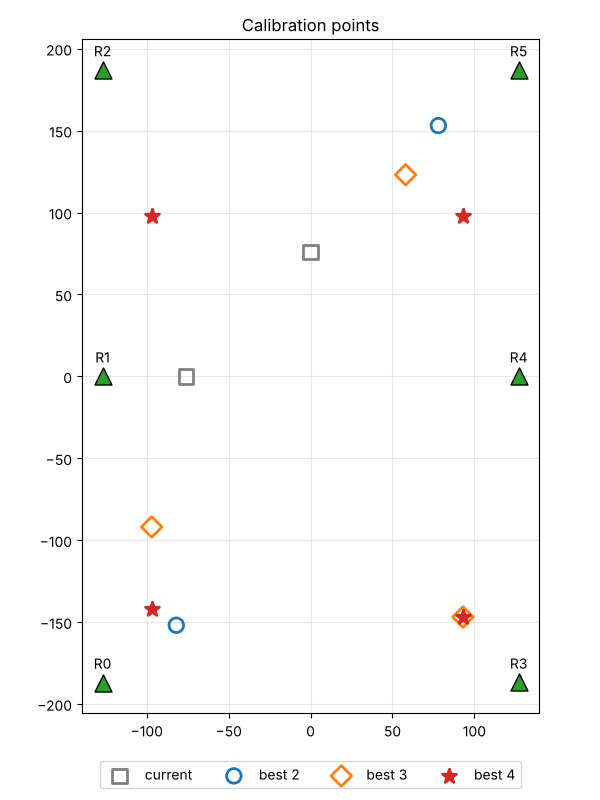

# UltraGPS positioning simulator

A standalone desktop simulator of the UltraGPS positioning system. It fakes the
six HC-SR04 receivers, feeds their tick counts into the **real**
`ultragps_position` library, and shows every positioning algorithm solving the
same frame side by side.


## Run it

Python 3.11 or later:

```bash
python3 -m pip install -r requirements.txt
python3 app.py
python3 app.py --config path/to/config.toml --sensors path/to/sensors.toml --max-differential 50 --max-distance 400 --seed 1
```

It reads receiver positions and calibration from `config/config.toml`, a copy
of UltraGPS-Control's config, so the arena matches the real one. Point
`--config` at another config.toml to simulate a different arena.

## Relationship to the other UltraGPS repositories

This repository is self-contained and does not modify or depend on any other
repository at run time. These are copied in from
[UltraGPS-Control](https://github.com/Imperious22M/UltraGPS-Control) at commit
`f8f4f73`:

- `ultragps_position/` — the positioning library (`libs/ultragps_position`)
- `ultragps_calibration/` — the calibration library (`libs/ultragps_calibration`),
  extended from two to up to four calibration points (see Calibration below)
- `config/config.toml` — receiver positions and calibration; the simulator's
  calibration routine and calibration window write new offsets into it

The library copy has **two changes** from that commit, both in the sanity
filter `_filter_receivers`:

1. A distance must be greater than 0 to be kept.
2. The upper bound is a **top-band reject**, `max_distance`, a new optional
   constructor argument and attribute. `None` (the default) keeps the original
   bound, the widest receiver spacing (about 452 cm here). A receiver that
   loses the signal can report a very high value, which this rejects.

```python
# was: within_bounds = arr <= self._max_receiver_dist
top           = self.max_distance if self.max_distance is not None else self._max_receiver_dist
within_bounds = (arr > 0) & (arr <= top)
```

A receiver that is off, misses its echo, or is out of range reports 0 ticks,
which calibrates to its intercept, a negative distance (R5: −150.5 cm). The
original bounds check only rejected distances that were too long, and the jump
filter only rejects the frame where a value changes, so from the second frame
on a dead receiver was kept and LM and OLS went badly wrong (R5 off at
(30, 50): LM about 92 cm off). UltraGPS-Control still has the original check.

To pick up later library changes, copy the folder over again and re-apply
these changes (`diff` against UltraGPS-Control shows them).

## What you can do

| Control | Effect |
|---------|--------|
| Click the arena | The transmitter moves there at the set speed |
| **Circle path** | The transmitter drives a 100 cm circle |
| **Receivers** R0–R5 | Switch a receiver off (it reports 0 ticks, as unused pins do) |
| **Algorithms** | Show or hide each solver's estimate |
| Noise σ | Gaussian range noise in cm |
| Dropouts | Chance a reading is missed and reported as 0 ticks |
| Lost signal | Chance the sensor loses the signal and reports a high value (its ~38 ms echo timeout, about 13 m) |
| Bad values | Chance a reading is wrong (multipath, EMI) |
| Bad value range | How wrong: the measured range off by a random amount within ± this % |
| Air temp | Speed-of-sound change against the 20 °C calibration |
| Speed | How fast the transmitter moves |
| Top-band reject | The library filter drops any distance above this (default: widest receiver spacing) |
| Timestep | Simulated seconds per frame, and the time between frames when running |
| **Pause** / **Step** | Stop the run / advance exactly one frame (Step pauses first) |
| **Field of view (±15°)** | Under the map. Each receiver only hears the transmitter within ±15° of the direction it faces (red dashed lines); outside, it drops out (0 ticks) |
| **Near-receiver noise** | Under the map. Within 4% of the 400 cm range (16 cm) of a receiver, its reading gets extra noise (σ 5 cm) |
| **Cal points: N** | Choose how many calibration points (2, 3 or 4) Search and Manual selection place |
| **Search points** | Find the best N points with the search below, show them on the arena and save them |
| **Manual selection** | Click N points on the arena instead (press again to cancel) |
| **Calibrate** | Run the calibration library's routine on the simulated sensors at those points (see below) |
| **Modify calibration values** | Open a window to edit each receiver's slope and intercept, then **Save & apply** |

The panel on the right shows each algorithm's current and RMS error against the
true position, how many frames it failed, which receivers the library's filter
kept, which subset CEP picked, and the raw ticks and distances per receiver.
When fewer than 3 receivers are kept, no solver runs: LM and CEP hold their
last good fix, the frame counts as a failure, and CEP shows no subset.

On the arena, each receiver's colour shows what its sensor did this frame
(green ok, grey off, orange missed or out of range, red bad value), a thick
outline marks the receivers CEP used, and each ring is the measured range —
solid if the library kept that reading, dotted red if its filter dropped it.

## Algorithms shown

OLS, LM and CEP come from `ultragps_position`; all four see the same filtered receivers,
because the simulator calls `get_position_full()` exactly as UltraGPS-Control's
`windows/position_window.py` does.

- **OLS** — linear least squares on the squared-range differences. This is the
  seed both other solvers start from.
- **LM** — the OLS seed refined by Levenberg-Marquardt over all kept receivers.
- **CEP** — tries every subset of 3 or more kept receivers (42 subsets with
  all six) and keeps the one with the smallest Circular Error Probable,
  falling back to the last good fix when out of bounds. The library's own
  default stops after 15 subsets; the simulator raises that cap through the
  library's `max_subsets` argument, so the library code itself is unchanged.
- **CEP4** — a simulator-only variant for comparison; it is not in the
  library. Each subset is still solved with the library's OLS + LM, but:
  - only subsets of **4 or more** receivers are tried, so a bad reading can't
    hide inside a 3-receiver fit (three ranges almost always fit a 2D point);
  - fixes **outside the receivers' bounding box are kept** instead of being
    replaced by the last good fix;
  - the score is the textbook CEP, `0.59·(σx + σy)` from
    `s²·(JᵀJ)⁻¹` with `s² = Σresidual² / (m − 2)`. The library weights each
    receiver by `1 / (|residual| + 0.1)`, which rewards fits where some
    residuals are near zero.

  With fewer than 4 kept receivers it holds its last fix, and with exactly 4
  kept it has no subset to choose, so a bad reading among those 4 gets through.

## Calibration

There are two sets of per-receiver offsets (`distance_cm = tick × slope + intercept`):

| File | What it is | Used by |
|------|-----------|---------|
| `config/sensors.toml` | The simulated hardware's **true** response | The sensor model, to turn distances into ticks |
| `config/config.toml` | The **calibration**, what the system believes | The positioning library, to turn ticks back into distances |

Both start from the real calibration. When they differ, every distance the
library sees is off by the calibration error, as on the real system.

**Calibrate** runs `UltraGPSCalibration.run_full_calibration()` from the real
calibration library. `SimClient` in `calibration.py` stands in for the network
client: each `pulse()` measures the simulated sensors with the transmitter
parked on each calibration point in turn (P1, P2, ... on the arena). The
library collects readings until each receiver's most frequent tick has been
seen `calibration_reads` times, fits slope and intercept, and writes them to
`config.toml`. The simulator then reloads the positioning
library, so the new offsets are used straight away. The current noise, faults,
temperature and switched-off receivers all apply during calibration, so you
can see how they turn into calibration error. A receiver whose two calibration
distances are close together (R3: 292 vs 276 cm) gets a noticeably less
accurate slope, because a one-tick difference matters more over a short span.

**Modify calibration values** opens a window listing each receiver's slope and
intercept from `config.toml`, with the true values from `sensors.toml` for
reference. **Save & apply** writes the edited values through the calibration
library's `save_offsets()` and reloads the positioning library. **Reload from
file** discards unsaved edits. To model hardware that has drifted from its
calibration, edit `sensors.toml` instead.

### Choosing calibration points

`cal_points.py` searches for the set of 2, 3 or 4 calibration points that
gives each receiver the most accurate slope and intercept, then checks the
winners by calibrating many times on the simulated sensors:

```bash
python3 cal_points.py                 # best 2, 3 and 4 points, check, plot to cal_points.png
python3 cal_points.py --apply         # also write the best 4-point set into config.toml
```

A receiver's fit is accurate when its calibration points sit at very
different distances from it. The search scores a point set by the RMS distance
error its calibration would cause across the arena, for all six receivers
(this combines slope and intercept error in cm), searches a grid at least
`--margin` cm (default 30) inside the receivers' box and within 400 cm of
every receiver, and refines on a 5 cm grid. It is a local search, so the sets
are very good rather than proven optimal.

Result with 1 cm noise, 200 simulated calibrations per set:

| Set | Points (cm) | Slope error | Intercept error | Distance error |
|-----|-------------|-------------|-----------------|----------------|
| current | (0, 76), (−76, 0) | 2.76 % | 9.9 cm | 2.94 cm |
| best 2 | (−82, −152), (78, 153) | 0.64 % | 2.4 cm | 0.69 cm |
| best 3 | (−97, −92), (58, 123), (93, −147) | 0.47 % | 1.7 cm | 0.51 cm |
| best 4 | (−97, −142), (93, 98), (93, −147), (−97, 98) | 0.33 % | 1.2 cm | 0.40 cm |



`--apply` writes the best `--max-points` set into `config.toml`, as the
simulator's **Search points** button does.

### Calibrating with more than two points

The control program's calibration library takes exactly two points. The copy
here is extended to up to four, with as little change as possible:

- the points are `cal_points` in `config.toml` (a list of `[x, y]`), falling
  back to `cal_point_1` / `cal_point_2` when it is absent; `cal_point_1` /
  `cal_point_2` are still written as the first two points;
- each receiver's `cal_distances` has one distance per point;
- `run_full_calibration()` collects one run per point;
- the fit is a least-squares line through all (modal tick, distance) pairs,
  which for two points is exactly the original
  `slope = (d1 − d2) / (t1 − t2)`, `intercept = d1 − slope · t1`.

A `config.toml` with three or four points is not readable by UltraGPS-Control's
unmodified calibration library beyond its first two points.

## Sensor model

`sensor_model.py` turns a true position into ticks: straight-line range,
speed-of-sound scaling for temperature, Gaussian noise, then the faults above.
Ranges beyond the HC-SR04's 400 cm read as 0 ticks. With **Field of view** on,
a transmitter more than 15° off a receiver's facing direction (`facing_deg` in
`sensors.toml`; by default every receiver aims at the arena centre) also reads
as 0 ticks. With **Near-receiver noise** on, a receiver within 16 cm gets an
extra 5 cm of noise. Both also apply during calibration. A lost signal reads as the
distance sound travels in the HC-SR04's ~38 ms echo timeout (datasheet value;
the real board's figure may differ). A bad value is the measured range scaled
by a random factor within ±"Bad value range" %. Distances are converted to
ticks by inverting each receiver's true response from `sensors.toml`
(`tick = (d - intercept) / slope`).

## Code layout

| File | Role |
|------|------|
| `sensor_model.py` | Physics and faults: position → ticks |
| `solvers.py` | Runs each algorithm in the library on one frame |
| `calibration.py` | Runs the calibration library on the simulated sensors; reads and saves offsets |
| `cal_points.py` | Searches for the calibration points that minimise calibration error |
| `ultragps_position/` | Copy of the positioning library (two filter changes, above) |
| `ultragps_calibration/` | Copy of the calibration library (extended to up to 4 points) |
| `config/sensors.toml` | The simulated hardware's true tick response |
| `simulation.py` | Run state: moves the transmitter, steps sensor + solvers, tracks error |
| `app.py` | Matplotlib windows: simulator and calibration values |
| `test_simulator.py` | Headless checks: `python3 -m unittest test_simulator` |
