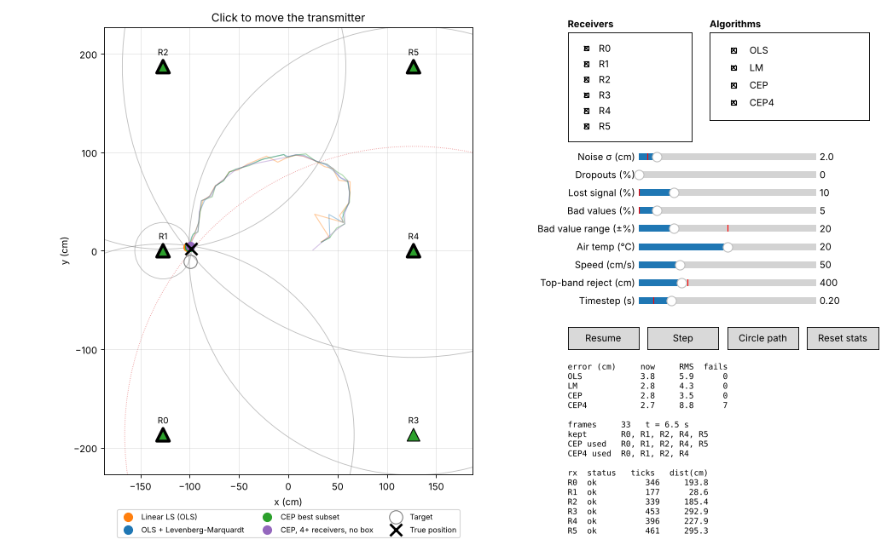

# UltraGPS positioning simulator

A standalone desktop simulator of the UltraGPS positioning system. It fakes the
six HC-SR04 receivers, feeds their tick counts into the **real**
`ultragps_position` library, and shows every positioning algorithm solving the
same frame side by side.



## Run it

Python 3.11 or later:

```bash
python3 -m pip install -r requirements.txt
python3 app.py
python3 app.py --config path/to/config.toml --max-differential 50 --max-distance 400 --seed 1
```

It reads receiver positions and calibration from `config/config.toml`, a copy
of UltraGPS-Control's config, so the arena matches the real one. Point
`--config` at another config.toml to simulate a different arena.

## Relationship to the other UltraGPS repositories

This repository is self-contained and does not modify or depend on any other
repository at run time. Two things are copied in from
[UltraGPS-Control](https://github.com/Imperious22M/UltraGPS-Control) at commit
`f8f4f73`:

- `ultragps_position/` — the positioning library (`libs/ultragps_position`)
- `config/config.toml` — receiver positions and calibration (unmodified)

The library copy has **two changes** from that commit, both in the sanity
filter `_filter_receivers`:

1. A distance must be greater than 0 to be kept.
2. The upper bound is a **top-band reject**, `max_distance`, a new optional
   constructor argument and attribute. `None` (the default) keeps the original
   bound, the widest receiver spacing (about 452 cm here). A receiver that
   loses the signal can report a very high value, which this rejects.

```python
# was: within_bounds = arr <= self._max_receiver_dist
top           = self.max_distance if self.max_distance is not None else self._max_receiver_dist
within_bounds = (arr > 0) & (arr <= top)
```

A receiver that is off, misses its echo, or is out of range reports 0 ticks,
which calibrates to its intercept, a negative distance (R5: −150.5 cm). The
original bounds check only rejected distances that were too long, and the jump
filter only rejects the frame where a value changes, so from the second frame
on a dead receiver was kept and LM and OLS went badly wrong (R5 off at
(30, 50): LM about 92 cm off). UltraGPS-Control still has the original check.

To pick up later library changes, copy the folder over again and re-apply
these changes (`diff` against UltraGPS-Control shows them).

## What you can do

| Control | Effect |
|---------|--------|
| Click the arena | The transmitter moves there at the set speed |
| **Circle path** | The transmitter drives a 100 cm circle |
| **Receivers** R0–R5 | Switch a receiver off (it reports 0 ticks, as unused pins do) |
| **Algorithms** | Show or hide each solver's estimate |
| Noise σ | Gaussian range noise in cm |
| Dropouts | Chance a reading is missed and reported as 0 ticks |
| Lost signal | Chance the sensor loses the signal and reports a high value (its ~38 ms echo timeout, about 13 m) |
| Bad values | Chance a reading is wrong (multipath, EMI) |
| Bad value range | How wrong: the measured range off by a random amount within ± this % |
| Air temp | Speed-of-sound change against the 20 °C calibration |
| Speed | How fast the transmitter moves |
| Top-band reject | The library filter drops any distance above this (default: widest receiver spacing) |
| Timestep | Simulated seconds per frame, and the time between frames when running |
| **Pause** / **Step** | Stop the run / advance exactly one frame (Step pauses first) |

The panel on the right shows each algorithm's current and RMS error against the
true position, how many frames it failed, which receivers the library's filter
kept, which subset CEP picked, and the raw ticks and distances per receiver.
When fewer than 3 receivers are kept, no solver runs: LM and CEP hold their
last good fix, the frame counts as a failure, and CEP shows no subset.

On the arena, each receiver's colour shows what its sensor did this frame
(green ok, grey off, orange missed or out of range, red bad value), a thick
outline marks the receivers CEP used, and each ring is the measured range —
solid if the library kept that reading, dotted red if its filter dropped it.

## Algorithms shown

OLS, LM and CEP come from `ultragps_position`; all four see the same filtered receivers,
because the simulator calls `get_position_full()` exactly as UltraGPS-Control's
`windows/position_window.py` does.

- **OLS** — linear least squares on the squared-range differences. This is the
  seed both other solvers start from.
- **LM** — the OLS seed refined by Levenberg-Marquardt over all kept receivers.
- **CEP** — tries every subset of 3 or more kept receivers (42 subsets with
  all six) and keeps the one with the smallest Circular Error Probable,
  falling back to the last good fix when out of bounds. The library's own
  default stops after 15 subsets; the simulator raises that cap through the
  library's `max_subsets` argument, so the library code itself is unchanged.
- **CEP4** — a simulator-only variant for comparison; it is not in the
  library. Each subset is still solved with the library's OLS + LM, but:
  - only subsets of **4 or more** receivers are tried, so a bad reading can't
    hide inside a 3-receiver fit (three ranges almost always fit a 2D point);
  - fixes **outside the receivers' bounding box are kept** instead of being
    replaced by the last good fix;
  - the score is the textbook CEP, `0.59·(σx + σy)` from
    `s²·(JᵀJ)⁻¹` with `s² = Σresidual² / (m − 2)`. The library weights each
    receiver by `1 / (|residual| + 0.1)`, which rewards fits where some
    residuals are near zero.

  With fewer than 4 kept receivers it holds its last fix, and with exactly 4
  kept it has no subset to choose, so a bad reading among those 4 gets through.

## Sensor model

`sensor_model.py` turns a true position into ticks: straight-line range,
speed-of-sound scaling for temperature, Gaussian noise, then the faults above.
Ranges beyond the HC-SR04's 400 cm read as 0 ticks. A lost signal reads as the
distance sound travels in the HC-SR04's ~38 ms echo timeout (datasheet value;
the real board's figure may differ). A bad value is the measured range scaled
by a random factor within ±"Bad value range" %. Distances are converted to
ticks by inverting each receiver's calibration (`tick = (d - intercept) / slope`),
so the library's own `tick * slope + intercept` recovers them.

## Code layout

| File | Role |
|------|------|
| `sensor_model.py` | Physics and faults: position → ticks |
| `solvers.py` | Runs each algorithm in the library on one frame |
| `ultragps_position/` | Copy of the positioning library (unmodified) |
| `simulation.py` | Run state: moves the transmitter, steps sensor + solvers, tracks error |
| `app.py` | Matplotlib window and controls |
| `test_simulator.py` | Headless checks: `python3 -m unittest test_simulator` |
